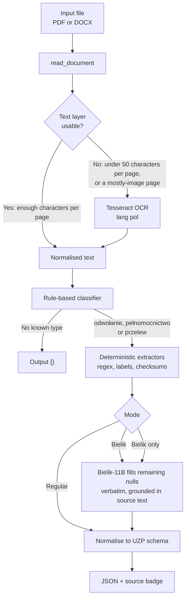

# PrzetarGO — Odwołania2JSON

**A rules-first extraction pipeline, with an optional Polish open model, that turns KIO case documents into UZP’s exact JSON — including scans and files that should be rejected.**

This is a draft README for the HackNation 2026 submission (Bydgoszcz). Replace every `[UPDATE: …]` marker before the repo goes public. Do not commit API keys, `.env` files, or the official training corpus if the public repo should stay lean.

---

## Problem

Each year, appeal cases before the National Appeal Chamber (Krajowa Izba Odwoławcza, KIO) arrive at the Public Procurement Office (Urząd Zamówień Publicznych, UZP) as bundles of PDFs. A case is not one file. It is a mix of appeals (*odwołania*), powers of attorney (*pełnomocnictwa*), transfer confirmations (*potwierdzenia przelewu*), and other paperwork that should be ignored. Some files are born-digital; others are image-only scans. Layouts vary, and the facts UZP needs are spread across those documents.

The challenge, [Odwołania2JSON](https://github.com/Urzad-Zamowien-Publicznych/hacknation-2026), is to classify each document, extract the business fields for that type, and write one JSON file per document in UZP’s published schema. Irrelevant documents must return `{}`. Missing values must be the JSON literal `null`, not the string `"null"`, and every template key must be kept.

Quality is measured as micro-F1 against UZP’s expected JSON, field by field, on a hidden test set of real cases.

- **Stage 1 (preselection):** F1 — 100%.
- **Stage 2 (final):** F1 — 50%; flexibility — 50% (model size 1–20 points, ease of adding new document types 1–20, extras 1–10).

[UPDATE: confirm Stage 2 weights against the latest organiser wording before the pitch.]

---

## Solution overview

PrzetarGO is a local web application: drop in a batch of files, watch each one being classified and extracted, and download UZP-shaped JSON. The pipeline is deterministic first, and only calls a language model when that helps fill gaps.



What happens at each step:

1. **Read the document.** PDFs are opened with PyMuPDF. If a page already has a usable text layer, that text is used and OCR is skipped. If the text layer is empty or shorter than 50 characters per page, the page is rendered and read with Tesseract 5.5 (`lang=pol`), after light preprocessing and deskew. OCR text is cleaned (including common digit confusions such as O→0 and l/I→1) and cached. DOCX support is being added with `python-docx`.
2. **Classify.** A rule-based classifier scores keyword evidence from the document-types config. If the best type is below the threshold, or the margin over the runner-up is too small, the document is rejected and the output is `{}`.
3. **Extract with rules.** Each known type has a deterministic extractor: label-aware regular expressions plus validators. IBAN/NRB, NIP, REGON and PESEL are checked with their official checksums. A value that cannot be validated is left as `null` rather than guessed.
4. **Optionally ask Bielik.** In Bielik mode, rules run first and the model is asked only to fill remaining `null` fields, copying values verbatim from the source text. In Bielik-only mode the model extracts everything, which we use for comparison. Prompts and answers are cached by `sha256(prompt + text)` so reruns are free.
5. **Normalise.** Field names, order and types are brought into line with UZP’s templates. The output keeps every key; missing values are `null`; rejected documents stay `{}`.

The UI (static front-end on port 8080, FastAPI in `back-end2/` on port 8000) supports drag-and-drop batches, rejects unsupported files without stopping the rest of the batch, shows a processing timer, and lets you inspect, copy or download JSON. Each document has a source badge (`text`, `ocr`, or `mixed`) and, in Bielik mode, “Rules ✓ Bielik” agreement badges on individual fields. Toggles cover JSON normalisation and cache bypass.

---

## Modes

| Mode | What it does | When to use it |
|---|---|---|
| **Regular** | Rules only. No model call. | Fast, free baseline. Good default for born-digital PDFs. |
| **Bielik** | Rules first, then Bielik fills remaining `null` fields. The UI shows where rules and the model agree. | Best accuracy when a field is present in the text but the regex missed it. |
| **Bielik only** | The model extracts every field. Rules are not the source of values. | Comparison and ablation, not the primary production path. |

All three modes share the same reader, classifier, validators and normaliser. The only difference is who is allowed to propose field values after classification.

---

## Results

Figures below are from `evaluate.py` on the official training data, run around 21:25 on 21 November 2026 (Europe/Warsaw). Scan scores were measured **before** a clean Polish-language OCR rerun and should be treated as a lower bound. They will be replaced before submission.

[UPDATE: final F1 — paste the latest `evaluate.py` tables here.]

| Split | Documents | Regular F1 | Bielik F1 | Notes |
|---|---:|---:|---:|---|
| Text PDFs | 180 | 0.983 | 0.979 | Born-digital training cases (`przyklad_01`–`60`) |
| Scans | 30 | 0.459 | 0.509 | **Work in progress, to update.** Image-only `dane/skany`; English OCR cache may still have been in use |
| Negatives | 16 | 1.000 | 1.000 | Irrelevant documents correctly returned `{}` |
| **Overall** | **226** | **0.927** | **0.926** | Micro-F1 across the splits above |

Additional reference points from earlier runs:

- Classifier accuracy on the 196 training documents (text PDFs + negatives): **196/196**.
- Bielik-only micro-F1 on text PDFs: **0.947**.

A wrong value counts as both a false positive and a false negative. Returning `null` for a field we cannot trust costs only a false negative, which is why validators prefer `null` to a number that fails its checksum.

---

## Quick start (Windows)

**Prerequisites**

- Python 3.11+ (or the version pinned in `back-end2/requirements.txt`)
- [Tesseract OCR 5.5](https://github.com/UB-Mannheim/tesseract/wiki) with Polish tessdata (`pol`). After install, `tesseract --list-langs` should include `pol`.
- For Bielik modes only: a Hugging Face Inference token with access to the model

**Setup**

1. Clone this repository and open a terminal in the project root.
2. Copy the environment template and edit it:

   ```bat
   copy backend\.env.example backend\.env
   ```

   Set at least:

   - `TESSERACT_CMD` — full path to `tesseract.exe` (typical install: `C:\Program Files\Tesseract-OCR\tesseract.exe`)
   - For Bielik modes: `LLM_BASE_URL`, `LLM_API_KEY`, and `LLM_MODEL` (default model name: `speakleash/Bielik-11B-v3.0-Instruct`)

   Never commit `backend\.env`.

3. Create the API virtual environment and install dependencies:

   ```bat
   cd back-end2
   python -m venv .venv
   .venv\Scripts\activate
   pip install -r requirements.txt
   cd ..
   ```

4. Start both servers:

   ```bat
   start_ui.bat
   ```

5. Open the UI at [http://127.0.0.1:8080](http://127.0.0.1:8080). The API listens on [http://127.0.0.1:8000](http://127.0.0.1:8000) (`/api/health`, `/api/extract/batch`).

**Official training data** (optional, for local evaluation) is published by UZP at [Urzad-Zamowien-Publicznych/hacknation-2026](https://github.com/Urzad-Zamowien-Publicznych/hacknation-2026), under `dane/` (`przyklad_01`–`60`, `negatywne/`, `skany/`). Point `evaluate.py` at a local copy; do not put secrets or large binary corpora into the public submission history.

---

## How to evaluate

Ground truth is UZP’s expected JSON only. Files are paired by folder and name. Irrelevant documents in `negatywne/` must produce `{}`.

```bat
python backend\scripts\evaluate.py --data UZP-hacknation-task\dane --mode regular
python backend\scripts\evaluate.py --data UZP-hacknation-task\dane --mode bielik
```

[UPDATE: confirm the exact CLI flags if they changed — `--data`, `--mode regular|bielik|bielik_only`, and cache on/off.]

The script flattens both JSON trees to leaf paths (list items by index), compares values after the same normalisation used in the output, and reports precision, recall and micro-F1 overall, per document type, and per split (text PDF / scan / negative). It also lists the most common failing fields.

Reports are written to:

- `reports/eval_<mode>_<timestamp>.json`
- `reports/eval_<mode>_<timestamp>.csv`

---

## How to add a new document type

This is designed to be a configuration change, not a rewrite. The classifier, the LLM fill-in step, the normaliser and the UI all read the same document-types config.

**Minimum (config only)**

1. Open the document-types configuration file (`backend/config/document_types.yaml`).
2. Add one new entry with:
   - a stable type id (this becomes the JSON wrapper key, in the same style as `odwolanie`, `pelnomocnictwo`, `przelew_bankowy`);
   - **classifier keywords** (and optional weights) so the existing scorer can recognise the type against the current threshold and margin;
   - the **output template** — every key, in the required order, with `null` as the default;
   - an **`llm_prompt`** that names each field and tells the model to copy values verbatim from the source text, or return `null`.
3. Restart the API. New documents of that type can already be classified, sent to Bielik, normalised and scored. Fields the model cannot find stay `null`.

**Optional (higher precision, still local)**

4. Add a small rule extractor for the new type (regexes for stable labels, plus any checksum or format validator). Register it next to the existing extractors. Regular mode will then fill those fields without a model call, and Bielik mode will only be asked for the gaps.

5. Add a few fixtures (a typical PDF or DOCX, plus the expected JSON) and run `evaluate.py` on them. No change to the API contract or the UI is required: a new type appears in the same per-document field list.

That is the whole extension path: one config entry, an optional extractor, and tests. The rest of the system stays as it is.

---

## Model choice

The only language model in the pipeline is **[Bielik-11B-v3.0-Instruct](https://huggingface.co/speakleash/Bielik-11B-v3.0-Instruct)** (`speakleash/Bielik-11B-v3.0-Instruct`), an open 11B-parameter instruction model trained for Polish. It is small enough to keep the “model size” score honest, and it is a natural fit for Polish legal and administrative wording.

We call it through the Hugging Face Inference router, with an OpenAI-compatible client configured by `LLM_BASE_URL`, `LLM_API_KEY` and `LLM_MODEL`. Approximate cost is **about $0.40 per 1 million tokens**. Rules run first, so most fields never reach the model, and prompt/response caching means a repeated document costs nothing. Regular mode uses no model at all.

Hosting note: the current endpoint may be served via Hugging Face / Public AI infrastructure in Switzerland. Document text is sent only as a prompt for inference and is not used to train the model. **This should be confirmed with the organisers before the final pitch**, in case they require an EU-hosted or on-premise endpoint (for example PSNC or Sherlock) for the official run.

The system itself is designed to be runnable on-premise without a GPU: the heavy model is accessed over an API, as the brief requires, and every component we ship is open source.

---

## Project structure

```
├── start_ui.bat              # starts the API (port 8000) and the static UI (port 8080)
├── front-end/                # drag-and-drop UI
├── back-end2/                # FastAPI application (live server)
│   ├── api.py
│   ├── requirements.txt
│   └── .venv/
├── backend/                  # extraction pipeline, config, evaluation
│   ├── .env.example
│   ├── odwolania/            # document reader, classifier, extractors, normaliser
│   └── scripts/evaluate.py
├── reports/                  # evaluate.py JSON/CSV output
└── UZP-hacknation-task/      # optional local copy of official dane/ (not required to run the UI)
```

[UPDATE: tidy this tree to match the repo at freeze, including the DOCX reader path.]

---

## Team

- Marco Gnudi
- Wiktor ([wiktorw3](https://github.com/wiktorw3) on GitHub)

HackNation 2026, Bydgoszcz. Challenge set by Urząd Zamówień Publicznych.

---

## Limitations and next steps

- **Scans are the open quality gap.** OCR quality and checksum repair are being improved; the scan F1 figures in the table above are not final. If Polish OCR and validators are not enough, a small open vision model used only as a fallback on fields that fail validation is the next option — subject to organiser guidance on the model-size score.
- **DOCX input** is being added (`python-docx`, dispatched by extension and file signature). PDF remains the primary path required by the brief.
- **New document types** can already be added through the config, but we have not yet published a second official type beyond the three in the brief.
- **One-file, one-type** is the current assumption, matching the published `skany` set. Mixed bundles inside a single PDF would need page-level classification.
- **Handwriting, stamps and signatures** are not treated as values to extract; we read typed text.

We would welcome a follow-up with UZP on a pilot that generalises this same pipeline — config, rules, optional Bielik, normalisation — to other administrative document types.
